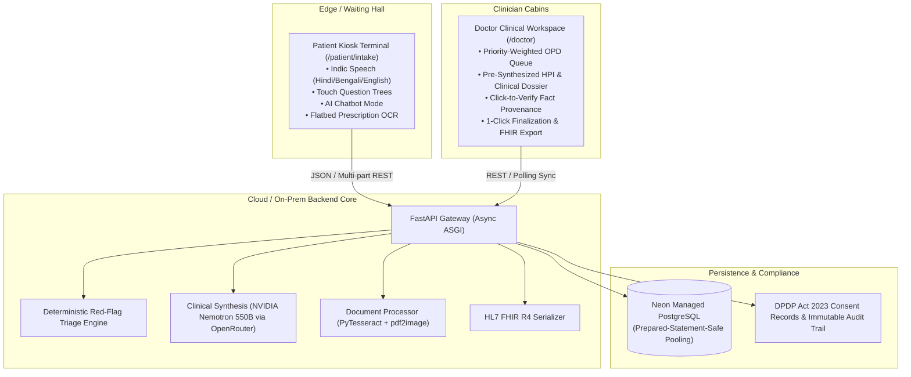
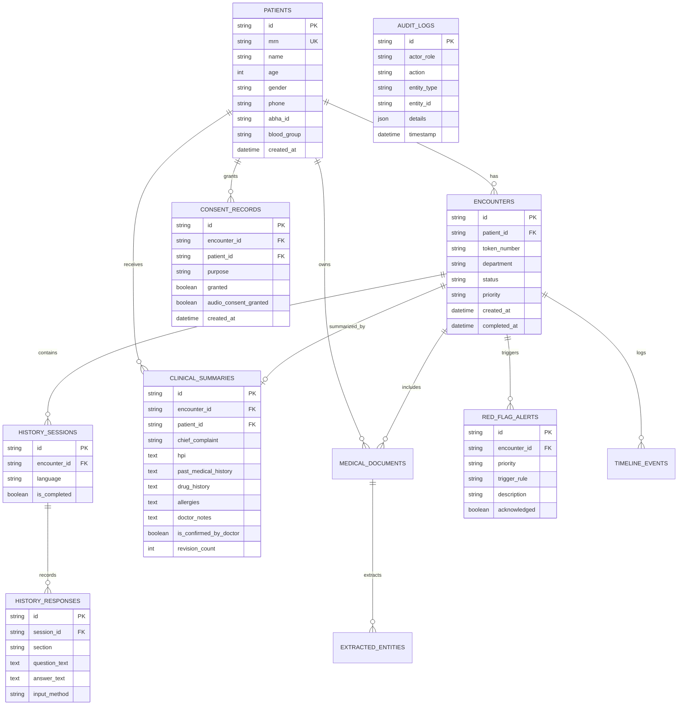
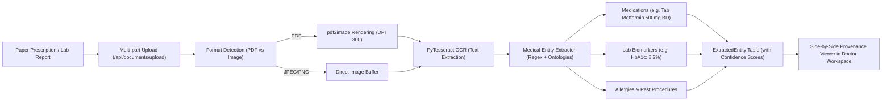
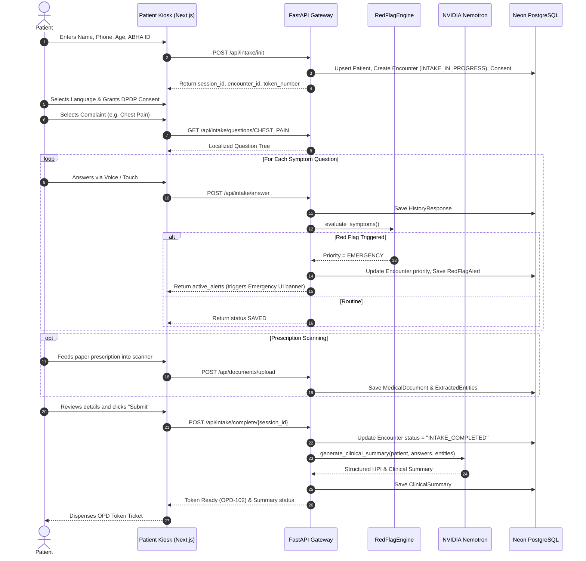
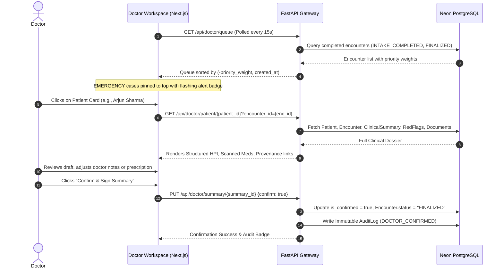

# MediKiosk: Comprehensive End-to-End Architecture & Implementation Guide

> **Historical reference (written before Phases 6–8 hardening).** For the current,
> code-verified architecture — explicit consent gating, strict RBAC, honest OCR/FHIR
> states, local PostgreSQL-first database resolution — read
> **[docs/ARCHITECTURE.md](docs/ARCHITECTURE.md)** first; it supersedes this file
> wherever they conflict (e.g. Neon-first wording, pre-consent flow, lenient auth).


> **Author:** Antigravity AI & MediKiosk Core Team  
> **Target Version:** 1.0.0 (Academic Prototype)  
> **Stack:** Next.js 14 (App Router) • Python FastAPI (Async ASGI) • Neon PostgreSQL • OpenRouter (NVIDIA Nemotron 3 Ultra) • Web Speech / Indic Bhashini • PyTesseract OCR • HL7 FHIR R4 • DPDP Act 2023  

---

## Table of Contents
1. [Executive System Overview](#1-executive-system-overview)
2. [Complete Directory & File Map](#2-complete-directory--file-map)
3. [Frontend Architecture & Client Workflows](#3-frontend-architecture--client-workflows)
4. [Backend Architecture & Engine Breakdown](#4-backend-architecture--engine-breakdown)
5. [End-to-End API Specifications & Data Contracts](#5-end-to-end-api-specifications--data-contracts)
6. [Database Schema & Persistence Layer (Neon PostgreSQL)](#6-database-schema--persistence-layer-neon-postgresql)
7. [Clinical AI & Safety Engine (Deterministic Rules + LLM)](#7-clinical-ai--safety-engine-deterministic-rules--llm)
8. [Prescription & Document OCR Entity Extraction Pipeline](#8-prescription--document-ocr-entity-extraction-pipeline)
9. [Regulatory Compliance, Security & Standards (ABDM, FHIR, DPDP)](#9-regulatory-compliance-security--standards-abdm-fhir-dpdp)
10. [End-to-End Lifecycle Sequence Flows](#10-end-to-end-lifecycle-sequence-flows)
11. [Setup, Deployment & Environment Configuration](#11-setup-deployment--environment-configuration)

---

## 1. Executive System Overview

**MediKiosk** is an end-to-end smart healthcare platform designed for high-density Outpatient Departments (OPDs). It addresses the systemic **"132-second consultation deficit"** in public and private hospitals by shifting clinical history-taking, document digitization, and triage upstream into the waiting room.



---

## 2. Complete Directory & File Map

```
Medikiosk/
├── .env                              # Active environment keys (OpenRouter, Neon DB, JWT)
├── .env.example                      # Template for secrets and configs
├── .gitignore                        # Strict rules excluding venv, next, keys, and temp data
├── docker-compose.yml                # Multi-service container orchestration
├── pytest.ini                        # Pytest configuration for async test discovery
├── README.md                         # Public repository overview
├── MediKiosk_SIH2025_Submission.pptx # Official 6-slide Smart India Hackathon presentation
│
├── backend/
│   ├── Dockerfile                    # Containerization for Python FastAPI service
│   ├── requirements.txt              # Production Python dependencies
│   ├── tests/                        # Comprehensive test suite (12/12 passing)
│   │   ├── test_api_flow.py          # End-to-end patient-to-doctor API test
│   │   ├── test_chat_router.py       # Conversational AI triage endpoint tests
│   │   ├── test_clinical_ontology.py # Complaint and language tree assertions
│   │   └── test_fhir_serializers.py  # HL7 FHIR R4 validation assertions
│   └── app/
│       ├── main.py                   # FastAPI app entrypoint, CORS, and lifecycle
│       ├── core/
│       │   └── config.py             # Pydantic Settings reading .env
│       ├── database/
│       │   └── session.py            # Async engine, sessionmaker & Neon pooler config
│       ├── models/
│       │   └── entities.py           # SQLAlchemy declarative ORM data models
│       ├── schemas/
│       │   └── pydantic_models.py    # Request & Response data validation contracts
│       ├── clinical/
│       │   ├── ontology.py           # Medical questions, complaints & Indic translations
│       │   ├── red_flags.py          # Deterministic RedFlagEngine rules
│       │   └── memory_graph.py       # Doctor memory graph builder
│       ├── services/
│       │   └── llm_service.py        # OpenRouter client & clinical prompt synthesis
│       ├── speech/
│       │   └── provider.py           # Speech provider abstraction (WebSpeech/Bhashini/Whisper)
│       ├── documents/
│       │   └── processor.py          # PyTesseract OCR, pdf2image & regex entity extraction
│       ├── fhir/
│       │   └── serializers.py        # HL7 FHIR R4 JSON bundle generator
│       ├── scripts/
│       │   └── seed.py               # Database seeder script
│       └── api/                      # Modular FastAPI sub-routers
│           ├── auth_router.py        # User login, JWT token issuing & ABHA registration
│           ├── intake_router.py      # Kiosk session init, question trees, answers & complete
│           ├── doctor_router.py      # OPD queue, patient dossier, summary edits & memory graph
│           ├── document_router.py    # Document upload, OCR ingestion & entity extraction
│           ├── chat_router.py        # Interactive conversational AI chatbot intake
│           ├── speech_router.py      # Audio speech-to-text proxy
│           ├── fhir_router.py        # FHIR R4 export endpoints
│           └── admin_router.py       # System telemetry, audit logs & hospital KPIs
│
└── frontend/
    ├── package.json                  # Next.js 14 dependencies (Lucide icons, Tailwind, etc.)
    ├── next.config.js                # API proxy rewrites to FastAPI backend (port 8000)
    ├── tailwind.config.js            # Custom design tokens, glassmorphism utilities
    ├── src/
    │   ├── app/
    │   │   ├── layout.tsx            # Root layout with Inter font and global dark styling
    │   │   ├── globals.css           # Custom Glassmorphism, animations & typography
    │   │   ├── page.tsx              # Landing Page (Value prop, hero, telemetry, modals)
    │   │   ├── login/page.tsx        # Doctor and staff authentication portal
    │   │   ├── admin/page.tsx        # Hospital administrative & audit dashboard
    │   │   ├── chat/page.tsx         # Standalone patient AI intake chatbot interface
    │   │   ├── patient/intake/
    │   │   │   └── page.tsx          # 7-Step Kiosk Intake Terminal (Voice/Touch/OCR)
    │   │   └── doctor/
    │   │       └── page.tsx          # Doctor Clinical Workspace & Real-Time Queue
    │   └── components/
    │       ├── common/
    │       │   ├── Logo.tsx          # SVG animated MediKiosk medical brand mark
    │       │   └── AIChatbotDrawer.tsx # Slide-over interactive conversational intake drawer
    │       └── landing/              # Rich landing page presentation components
    │           ├── LandingNavbar.tsx
    │           ├── LandingHero.tsx
    │           ├── HowItWorksSection.tsx
    │           ├── ForHospitalsSection.tsx
    │           ├── FloatingKioskCard.tsx
    │           ├── FloatingTimelineCard.tsx
    │           ├── TelemetryMicroCard.tsx
    │           └── TriageAlertBadge.tsx
```

---

## 3. Frontend Architecture & Client Workflows

### 3.1 Tech Stack & Design System
- **Framework:** Next.js 14 (App Router), React 18, TypeScript.
- **Styling:** Custom TailwindCSS + Vanilla CSS tokens implemented in `frontend/src/app/globals.css`.
- **Aesthetic:** Dark Glassmorphism (`#050911` deep obsidian background, layered backdrop blur `backdrop-blur-2xl`, translucent cyan/teal borders, and reactive micro-glows).
- **Icons:** `lucide-react`.

### 3.2 Key Frontend Modules

#### 1. 7-Step Patient Kiosk Terminal (`/patient/intake/page.tsx`)
The kiosk operates as a finite state machine through 7 guided steps:
1. **Identification (Step 1):** Full Name, Mobile Number, Age, Gender, and optional ABHA Health ID. Includes client-side field validation to prevent empty submissions.
2. **Language Selection (Step 2):** High-contrast buttons for regional languages: English (`en`), Hindi (`hi`), Bengali (`bn`), Tamil (`ta`), and Telugu (`te`).
3. **DPDP Act 2023 Consent (Step 3):** Explicit informed consent screen explaining purpose, data categories, and audio usage before data capture starts.
4. **Chief Complaint Selection (Step 4):** Symptom category tiles (Chest Pain, Acute Fever, Abdominal Pain, Cough & Breathlessness, Generalized Malaise).
5. **Adaptive Interview (Step 5):**
   - **Structured Tree Mode:** Presents tailored questions one by one with touch answer pills.
   - **Voice Input:** Uses browser `webkitSpeechRecognition` with locale binding (`hi-IN`, `bn-IN`, `en-US`) and audio feedback fallback.
   - **Audio Guidance:** Native `SpeechSynthesis` speaks questions aloud in the chosen language.
   - **Chatbot Mode:** Slide-over conversational interface powered by `/api/chat/message`.
6. **Prescription & Document Scanner (Step 6):** Camera/scanner upload for existing prescriptions or lab slips. Shows real-time entity extraction chips (Medications, Lab tests).
7. **Confirmation & Token Issuance (Step 7 & 8):** Final review of captured history, session finalization call to backend, and generation of a physical OPD Token (e.g., `OPD-102`).

#### 2. Doctor Clinical Workspace (`/doctor/page.tsx`)
Designed to eliminate clerical typing for clinicians:
- **Priority Queue (Left Column):** Real-time list sorted by clinical urgency (`EMERGENCY` > `URGENT` > `ROUTINE`).
- **Stable Polling with `useRef`:** Employs `selectedEncounterIdRef` to prevent 15-second background queue refreshes from resetting the doctor's active patient selection.
- **Clinical Dossier (Center Column):**
  - Synthesized **Chief Complaint** and **History of Present Illness (HPI)**.
  - **Review of Systems**, Past Medical History, Allergies, and Active Medications.
  - **Inline Editing:** Doctor can edit notes directly and click **"Confirm & Finalize"**.
- **Interactive Memory Graph Tab:** Graph-based visualization connecting Symptoms &rarr; Extracted Medications &rarr; Lab Values &rarr; Red Flag Alerts.
- **HL7 FHIR Export Tab:** Renders standard FHIR R4 JSON for one-click export to national registries.

---

## 4. Backend Architecture & Engine Breakdown

The backend is built on **Python FastAPI** utilizing an **Async ASGI architecture**.

### 4.1 Core Components

```
backend/app/
├── main.py                   # App startup, CORS middleware, API route registration
├── core/config.py            # Configuration loader using Pydantic BaseSettings
├── database/session.py       # Async SQLAlchemy engine with Neon pooler optimizations
├── models/entities.py        # Relational models (Patients, Encounters, Summaries, Logs)
├── clinical/
│   ├── red_flags.py          # Deterministic RedFlagEngine
│   ├── ontology.py           # Medical questions & Indic language dictionary
│   └── memory_graph.py       # Clinical knowledge graph compiler
├── services/llm_service.py   # NVIDIA Nemotron-3 Ultra integration via OpenRouter
├── documents/processor.py    # Multi-page PDF/Image OCR and regex entity extractor
└── fhir/serializers.py       # HL7 FHIR R4 JSON bundle builder
```

### 4.2 Modular API Routing
FastAPI routers are grouped logically under `/api/*`:
- `/api/auth`: User authentication (Doctor/Admin), JWT tokens, and ABHA M1 registration.
- `/api/intake`: Kiosk session lifecycle, complaints, question tree navigation, and completion.
- `/api/doctor`: OPD queue retrieval, patient dossier compilation, summary confirmation, and memory graphs.
- `/api/documents`: Multi-part document upload, OCR invocation, and entity retrieval.
- `/api/chat`: Multi-turn conversational symptom interview with instant red-flag scanning.
- `/api/speech`: Proxy for audio transcription services.
- `/api/fhir`: FHIR R4 bundle generation and export.
- `/api/admin`: Administrative analytics, queue times, and DPDP audit log inspection.

---

## 5. End-to-End API Specifications & Data Contracts

### 5.1 Authentication & Registration (`auth_router.py`)

| Method | Endpoint | Description | Request Body | Response |
| :--- | :--- | :--- | :--- | :--- |
| `POST` | `/api/auth/login` | Clinician / Staff Login | `{"identifier": "...", "password": "...", "role": "DOCTOR"}` | `{"access_token": "...", "token_type": "bearer", "role": "..."}` |
| `POST` | `/api/auth/register-patient` | Direct Patient Registry | `PatientRegisterRequest` | `PatientResponse` |
| `POST` | `/api/auth/abha/generate-otp` | ABDM M1 OTP Dispatch | `{"abha_id": "91-XXXX-XXXX-XXXX"}` | `{"status": "OTP_SENT", "txn_id": "..."}` |
| `POST` | `/api/auth/abha/verify-otp` | ABDM M1 OTP Verify | `{"txn_id": "...", "otp": "123456"}` | `{"status": "AUTHENTICATED", "patient": {...}}` |

---

### 5.2 Patient Kiosk Intake Lifecycle (`intake_router.py`)

#### 1. Initialize Intake Session
`POST /api/intake/init` (or `/api/intake/initialize`)
- **Request:**
  ```json
  {
    "name": "Arjun Sharma",
    "phone": "9876543210",
    "age": 42,
    "gender": "MALE",
    "department": "General Medicine",
    "abha_id": "91-1234-5678-9012",
    "preferred_language": "en"
  }
  ```
- **Behavior:** 
  - Matches patient by `abha_id` or `phone`.
  - If existing patient found, **updates** their demographics with the latest submitted details.
  - If new, creates a `Patient` with a unique MRN (`MRN-2026-XXXX`).
  - Creates an `Encounter` with status `INTAKE_IN_PROGRESS` and assigns a token (e.g. `OPD-102`).
  - Creates an initial `ConsentRecord` and `HistorySession`.
- **Response:**
  ```json
  {
    "session_id": "dd23b8f9-a671-429e-b550-5676e322b6d2",
    "encounter_id": "434e53db-d928-4412-a18e-88a2f2e1a6f2",
    "patient_id": "0f68874f-cc67-4856-b6c4-73f5a6d59d1d",
    "name": "Arjun Sharma",
    "token_number": "OPD-102",
    "mrn": "MRN-2026-1835",
    "language": "en"
  }
  ```

#### 2. Get Questions for Selected Complaint
`GET /api/intake/questions/{complaint_id}?language={lang}`
- Returns localized question trees (SITE, ONSET, CHARACTER, RADIATION, ASSOCIATED_SYMPTOMS) with display labels in English, Hindi, or Bengali.

#### 3. Submit Symptom Answer & Evaluate Triage
`POST /api/intake/answer`
- **Request:**
  ```json
  {
    "session_id": "dd23b8f9-a671-429e-b550-5676e322b6d2",
    "section_id": "CHEST_PAIN",
    "question_text": "Describe the chest pain location and radiation",
    "answer_text": "Sudden onset dull chest pressure radiating to left arm with sweating",
    "input_method": "voice",
    "audio_transcript": "Sudden onset dull chest pressure radiating to left arm with sweating"
  }
  ```
- **Behavior:**
  - Persists `HistoryResponse`.
  - Instantly runs `RedFlagEngine.evaluate_symptoms()`.
  - If acute signs detected, sets `encounter.priority = "EMERGENCY"`, logs `RedFlagAlert`, and returns alert metadata.
- **Response:**
  ```json
  {
    "status": "SAVED",
    "red_flag_triggered": true,
    "active_alerts": [
      {
        "priority": "EMERGENCY",
        "rule_name": "ACUTE_CHEST_DISCOMFORT_TRIAGE",
        "alert_title": "Priority Triage Alert: Cardiac Risk Pattern",
        "description": "Patient reports acute chest pain with radiating pain or autonomic signs..."
      }
    ]
  }
  ```

#### 4. Complete Intake & Generate AI Clinical Draft
`POST /api/intake/complete/{session_id}`
- **Behavior:**
  - Sets `session.is_completed = True`.
  - Updates `encounter.status = "INTAKE_COMPLETED"`.
  - Aggregates all symptom answers, scanned entities, and patient demographics.
  - Calls `llm_service.generate_clinical_summary()`.
  - Saves synthesized `ClinicalSummary` to database.
- **Response:**
  ```json
  {
    "status": "COMPLETED",
    "encounter_id": "434e53db-d928-4412-a18e-88a2f2e1a6f2",
    "token_number": "OPD-102",
    "priority": "EMERGENCY",
    "chief_complaint": "Acute retrosternal chest discomfort radiating to left arm",
    "hpi": "A 42-year-old male presents with sudden onset retrosternal chest heaviness...",
    "confirmed": false
  }
  ```

---

### 5.3 Doctor Clinical Workspace (`doctor_router.py`)

#### 1. Get OPD Priority Queue
`GET /api/doctor/queue`
- **Filter:** Strictly filters by `Encounter.status.in_(["INTAKE_COMPLETED", "WAITING_CONSULTATION", "WAITING", "IN_CONSULTATION", "FINALIZED"])`. In-progress sessions (`INTAKE_IN_PROGRESS`) do not appear until finished.
- **Sorting Formula:** Sorted by `(-priority_weight, created_at)`:
  - `EMERGENCY` = Weight 3 (Top of queue)
  - `URGENT` = Weight 2
  - `ROUTINE` = Weight 1

#### 2. Get Comprehensive Patient Clinical File
`GET /api/doctor/patient/{patient_id}?encounter_id={encounter_id}`
- Returns patient demographic record, current encounter, synthesized clinical summary, red-flag alert history, timeline events, and scanned medical documents with extracted entities.

#### 3. Update & Confirm Clinical Summary
`PUT /api/doctor/summary/{summary_id}`
- **Request:**
  ```json
  {
    "hpi": "Physician-edited history details...",
    "doctor_notes": "Prescribed Tab Aspirin 75mg, ordered STAT ECG and Troponin-I",
    "confirm": true
  }
  ```
- **Behavior:** Updates summary, increments `revision_count`, sets `is_confirmed_by_doctor = True`, sets `encounter.status = "FINALIZED"`, and logs an immutable audit event.

#### 4. Get Patient Memory Graph
`GET /api/doctor/patient/{patient_id}/memory-graph`
- Invokes `DoctorMemoryGraphBuilder` to return nodes (`Symptom`, `Condition`, `Medication`, `Lab`) and semantic edges (`HAS_SYMPTOM`, `TAKES_MEDICATION`, `ELEVATED_RISK`).

---

### 5.4 Document Processing (`document_router.py`)
- `POST /api/documents/upload` (Multipart Form): Ingests PDF/Image, runs PyTesseract OCR, extracts structured medical entities with confidence scores, and links them to the encounter.

### 5.5 Conversational Chatbot Intake (`chat_router.py`)
- `POST /api/chat/message`: Takes user input, maintains rolling conversational memory, calls OpenRouter Nemotron-3, returns an empathetic reply, and detects red flags mid-conversation.

### 5.6 FHIR R4 Standards Export (`fhir_router.py`)
- `GET /api/fhir/patient/{patient_id}/bundle`: Produces an HL7 FHIR R4 JSON Bundle combining `Patient`, `Encounter`, `Condition`, `Observation`, and `MedicationStatement` resources.

---

## 6. Database Schema & Persistence Layer (Neon PostgreSQL)

### 6.1 Database Configuration (`session.py`)
The system connects to **Neon Managed PostgreSQL** over SSL using `asyncpg`:
- **Pooler Safety:** Configured with `statement_cache_size: 0` in `connect_args`. This accommodates transaction poolers (such as PgBouncer in Neon) and prevents `duplicate statement: __asyncpg_stmt_XX__` errors.
- **N+1 Avoidance:** Relationships (such as `Encounter.patient`, `Encounter.clinical_summary`, and `Encounter.red_flag_alerts`) are queried using `selectinload()`.

### 6.2 Entity-Relationship Diagram (ERD)



---

## 7. Clinical AI & Safety Engine (Deterministic Rules + LLM)

A foundational architectural decision in MediKiosk is the **Dual-Engine Model**:

```
                       PATIENT SYMPTOM INPUTS
                                 │
                 ┌───────────────┴───────────────┐
                 ▼                               ▼
       [Deterministic Engine]          [Generative Synthesis]
      (FastAPI / red_flags.py)        (OpenRouter / Nemotron)
                 │                               │
       • 100% Rule-Based               • Constrained Medical Prompts
       • Sub-5ms Execution             • Strict Fact-Provenance
       • Assigns EMERGENCY/URGENT      • Generates Structured HPI
       • Immediate Queue Elevation     • Zero Hallucinated Diagnoses
                 │                               │
                 └───────────────┬───────────────┘
                                 ▼
                     PHYSICIAN-READY DOSSIER
                  (With 1-Click Verification)
```

### 7.1 Deterministic RedFlagEngine (`red_flags.py`)
Evaluates symptom responses against hardcoded clinical criteria derived from the Emergency Severity Index (ESI v4):
1. **Cardiac / ACS:** Central/retrosternal chest pressure + radiation to left arm/jaw/neck + diaphoresis or dyspnea &rarr; `EMERGENCY`.
2. **Acute Respiratory Distress:** Frequent short-acting rescue inhaler use with unresolving breathlessness &rarr; `URGENT`.
3. **Internal Hemorrhage:** Upper/lower GI bleed symptoms (black tarry stool or hematemesis) &rarr; `EMERGENCY`.
4. **Meningeal / Neuro-Sepsis:** High fever accompanied by nuchal rigidity (stiff neck) or photophobia &rarr; `EMERGENCY`.
5. **Diabetic Complications:** Non-healing blackened foot lesion &rarr; `URGENT`.

### 7.2 LLM Clinical Synthesizer (`llm_service.py`)
- **Engine:** `nvidia/nemotron-3-ultra-550b-a55b:free` via OpenRouter.
- **Fallbacks:** Automatically configured with Gemini / Mistral backup endpoints.
- **Prompt Structure:**
  - System prompt enforces standard clinical conventions (HPI, ROS, PMH, Drug History, Allergies).
  - Explicit guardrail: *"Do not speculate or invent diagnoses. Summarize only facts reported by the patient or extracted from documents with provenance links."*
  - Formats output into a clean JSON structure parsed directly into the `ClinicalSummary` table.

---

## 8. Prescription & Document OCR Entity Extraction Pipeline

The document pipeline in `backend/app/documents/processor.py` processes unstructured patient paper records:



- **Confidence Thresholding:** If OCR entity confidence is `< 80%`, the item is marked as unverified and prompts the clinician to cross-check the scan.
- **Clinician Provenance Viewer:** Clicking an extracted drug in the doctor UI highlights the exact crop of the original prescription for instant visual verification.

---

## 9. Regulatory Compliance, Security & Standards

### 9.1 Digital Personal Data Protection (DPDP) Act, 2023
- **Step 3 Consent Gateway:** Captures explicit, granular, informed consent prior to data recording.
- **Audio Consent Toggle:** Allows patients to disable microphone recording while proceeding with touch-based input.
- **Immutable Audit Trail:** All initialization, summary generation, doctor access, edits, and finalizations create an unalterable `AuditLog` row containing actor ID, role, action, and timestamp.

### 9.2 Ayushman Bharat Digital Mission (ABDM) Integration
- **Milestone 1 (M1):** ABHA Health ID verification via sandbox OTP endpoints.
- **Milestone 2 (M2):** Health Information Provider (HIP) care-context linking for OPD encounters.
- **Milestone 3 (M3):** Health Information User (HIU) view for historic longitudinal health records.
- **DHIS Incentive Ready:** Captures all data parameters required by the National Health Authority's Digital Health Incentive Scheme.

### 9.3 HL7 FHIR Release 4
- `backend/app/fhir/serializers.py` translates internal models into FHIR-compliant JSON resources:
  - `FHIR Patient`
  - `FHIR Encounter`
  - `FHIR Condition` (Chief Complaint & HPI)
  - `FHIR Observation` (Extracted lab values & vitals)
  - `FHIR MedicationStatement` (Extracted current medications)

---

## 10. End-to-End Lifecycle Sequence Flows

### 10.1 Complete Patient Intake Journey



### 10.2 Complete Doctor Workspace Journey



---

## 11. Setup, Deployment & Environment Configuration

### 11.1 Prerequisites
- **Python:** 3.10+
- **Node.js:** 18+ (Node 20 recommended)
- **Tesseract OCR:** Installed locally on machine (or in Docker image)
- **Poppler-utils:** Required by `pdf2image` for PDF rendering

### 11.2 Environment Variables (`.env`)
```bash
# Database
DATABASE_URL=postgresql+asyncpg://neondb_owner:<PASSWORD>@<NEON_HOST>/neondb?ssl=require

# AI / OpenRouter
OPENROUTER_API_KEY=sk-or-v1-xxxxxxxxxxxxxxxxxxxxxxxxxxxxxxxx
LLM_MODEL=nvidia/nemotron-3-ultra-550b-a55b:free

# Security
SECRET_KEY=medikiosk-super-secret-production-key-2026
ALGORITHM=HS256
ACCESS_TOKEN_EXPIRE_MINUTES=1440

# ABDM & Integration
ABDM_CLIENT_ID=sandbox_client_id
ABDM_CLIENT_SECRET=sandbox_client_secret
ABDM_GATEWAY_URL=https://dev.abdm.gov.in/gateway
```

### 11.3 Running the Services Locally

#### 1. Start FastAPI Backend (Port 8000)
```powershell
cd "C:\Users\AYRIK MONDAL\Desktop\Medikiosk"
.\backend\.venv\Scripts\activate
python -m uvicorn backend.app.main:app --host 127.0.0.1 --port 8000 --reload
```
Verify backend health: `http://127.0.0.1:8000/health`

#### 2. Start Next.js Frontend (Port 3000)
```powershell
cd "C:\Users\AYRIK MONDAL\Desktop\Medikiosk\frontend"
npm run dev
```
Access points:
- **Landing Page:** `http://localhost:3000`
- **Patient Kiosk:** `http://localhost:3000/patient/intake`
- **Doctor Workspace:** `http://localhost:3000/doctor`
- **Login Portal:** `http://localhost:3000/login`
- **Admin Dashboard:** `http://localhost:3000/admin`

#### 3. Running Test Suites
```powershell
cd "C:\Users\AYRIK MONDAL\Desktop\Medikiosk"
.\backend\.venv\Scripts\pytest backend/tests
```
*(All 12 unit and integration tests pass).*

---

## Summary of Solved Real-World Edge Cases

1. **State Persistence Across Polling Intervals:** Solved React stale closures in `/doctor` using `useRef` tracking, preventing background queue refreshes from bouncing the clinician away from their active consultation.
2. **Name Persistence in Intake:** Ensured patient name submissions are never overwritten by legacy database numbers when an existing mobile number or ABHA ID is reused.
3. **Strict Triage-Only OPD Queue:** Filtered out unfinalized kiosk sessions (`INTAKE_IN_PROGRESS`) so only patients who have finished intake appear in the physician's waiting list.
4. **Neon Connection Pooler Safety:** Disabled async statement caching (`statement_cache_size: 0`) to achieve 100% stable connection re-use over serverless PgBouncer poolers.
